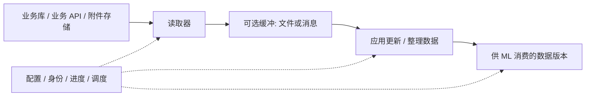

# 01｜先把“搬数据”拆成真正发生的动作

假设售后每天产生新工单，答案会审核修订，附件在对象存储里。ML 平台每周要一份问答训练集。这个需求可以用多种产品完成，但它们都绕不开几个动作。

## 1. 谁从源系统把第一批数据读出来？

可能是你的 Kubernetes Job 发 SQL，也可能是数据库复制服务读取表和日志，还可能是业务系统自己生成导出文件。关键是画出“谁读取、从哪里读取”，不能在源系统旁画一个数据湖就跳过读取过程。

“缓冲”可以只是已有 OBS 的一组目录，不一定是 Kafka；“整理数据”可以在同一个 Job 中，不一定是湖仓。这张图描述责任，不规定必须部署几个服务。

## 2. 第一次搬运和后续搬运不是同一问题

第一次要得到已有工单，这叫初始化或回填。后续只想取得新工单和修订，这叫增量。数据库日志可能只保留近期变化，所以不能只订阅今天开始的日志就认为历史数据也有了。

源数据一直变化时，初始化读到一半发生更新，还必须处理两阶段交接。[Debezium 的快照与 binlog 说明](https://debezium.io/documentation/reference/stable/connectors/mysql.html)就是在处理这类边界。具体算法交给成熟连接器，不应靠手工记录两个时间戳猜测衔接点。

## 3. “搬到哪里”决定了搬运服务负责多少

| 交付物 | ML 平台收到什么 | 还要自己做什么 |
|---|---|---|
| 完整导出文件 | 本批查询或快照结果 | 检查一致性、清洗、版本发布 |
| 变更事件 | 新增/修改/删除记录 | 去重、按顺序合并到当前状态 |
| 湖仓中的最新表 | 已经应用更新的状态 | 授权筛选、样本构建、固定版本 |
| 远程查询入口 | 访问外部数据的接口 | 明确查询仍在哪里执行，是否还需要复制 |
| 业务定义的数据产品 | 已选择业务含义和范围的数据 | 验证合同、格式转换、消费审计 |

例如，Snowflake Openflow 同时维护变化 journal 与当前表，而 Fabric Open Mirroring 接受生产者交付的变更后应用到 Delta。它们托管的边界并不相同。[Snowflake](https://docs.snowflake.com/en/user-guide/data-integration/openflow/connectors/mysql/about)、[Fabric](https://learn.microsoft.com/en-us/fabric/mirroring/open-mirroring)

## 4. 三组必须分开的选择

**读取机制**：SQL/文档查询、日志 CDC、文件复制、业务 API。

**读取位置**：生产主库、专用副本、已有快照、业务导出区。

**运行位置**：ML 平台网络中的执行器、靠近源的 agent、厂商托管服务。

例如“使用 agent”只改变运行位置，agent 发出的昂贵 SQL 仍然可能影响主库；“使用 CDC”改变读取机制，却可能仍需要连接主库；“使用湖仓”改变交付与处理位置，却没有自动决定第一跳。

## 5. 带着这些区分去读厂商

下一章看连接器如何搬；再下一章看湖仓如何接收和应用。这能避免把所有产品名字塞进同一张架构图，而说不清每个组件的工作。
