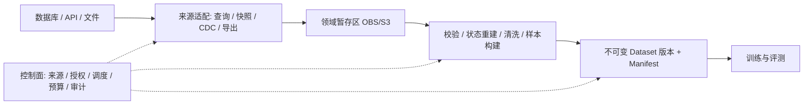

# data-ingestion：行业实践与整体方案

本版为官方公开资料支持的架构研究，未运行产品性能测试。不涉及内部访谈。

## 核心判断

数据库连接器 + Kubernetes Job + OBS/S3 是成立的实现方向。没有证据支持“行业统一禁止连接生产数据库”；厂商正式提供查询抽取及 CDC。产品支持连接不代表任意查询负载安全。架构师关于生产影响的担忧合理，但由此推导必须入湖或禁止所有直连，依据不足。

## 厂商比较与证据

| 厂商 | 官方实践 | 对本场景的意义 |
|---|---|---|
| AWS | DMS 全量与 CDC；建议低交易量时运行全量；RDS 支持快照导出到 S3 | 批量、日志复制、快照是不同路径 |
| Microsoft | ADF SQL Server 支持查询与分区并行复制，parallelCopies 控制并发 | 受控查询是正式产品模式，并发同时影响来源 |
| Google | Datastream 采用 CDC 和 backfill；回填可能有显著负载；至少一次交付 | CDC 不等于零影响，需去重与状态重建 |
| 阿里云 | DataWorks 支持批量、实时、全量和增量同步 | 按时效与更新语义选择策略 |
| 华为云 | CDM 支持作业抽取并发设置，实际分片依来源而异 | 可借鉴连接器和作业控制方式 |
| Databricks | Lakeflow 数据库连接器通过网关连接源库做 CDC | 源接入和下游消费分层；湖仓不是本项目必需 |

官方来源（本轮查阅）：

- [AWS DMS 最佳实践](https://docs.aws.amazon.com/dms/latest/userguide/CHAP_BestPractices.html)
- [DMS 全量与延迟](https://docs.aws.amazon.com/dms/latest/userguide/CHAP_Troubleshooting_Latency.html)
- [RDS 快照导出](https://docs.aws.amazon.com/AmazonRDS/latest/UserGuide/USER_ExportSnapshot.html)
- [Azure SQL Server 连接器](https://learn.microsoft.com/en-us/azure/data-factory/connector-sql-server)
- [Google Datastream FAQ](https://docs.cloud.google.com/datastream/docs/faq)
- [DataWorks 数据集成](https://www.alibabacloud.com/help/en/dataworks/user-guide/data-integration-overview)
- [华为 CDM 作业配置](https://support.huaweicloud.com/intl/zh-cn/usermanual-cdm/cdm_01_0153.html)
- [Databricks 数据库连接器](https://docs.databricks.com/aws/en/ingestion/lakeflow-connect/cdc-overview)
- [SageMaker Data Wrangler](https://docs.aws.amazon.com/sagemaker/latest/dg/data-wrangler.html)：从 S3、Athena、Redshift 等导入并进行 ML 数据准备，体现数据交付与样本准备的分层。

## 路径选择（工程建议，不是规范条文）

| 场景 | 优先评估 | 主要代价 |
|---|---|---|
| 低频、小范围、有索引 | 受控批查询，可用经容量验证的主库或副本 | 扫描、锁、连接、超时；LIMIT 不限制扫描成本 |
| 周期性大范围读取 | 专用副本或快照导出 | 副本成本、复制延迟、快照生成成本与支持范围 |
| 高频更新、持续同步 | 初始化 + CDC | 日志保留、回填、DDL、删除、乱序与重放 |
| 已有业务导出能力 | 批量 API 或文件推送 | API 仍可能冲击主库，需限流与一致性协议 |
| Hive/DWS 已有数据 | 分区裁剪及资源队列内抽取 | 分析集群也需要预算，避免重复整库复制 |
| 文档/会话/附件 | 对象清单 + 元数据或领域导出 | 文件与标签版本匹配、缺失对象、删除传播 |

低频后训练可从受控批量开始，不默认引入 CDC。只读副本必须确认用途，不能默认把高可用备用节点作为分析节点。具体规模阈值由测试确定。

## 整体架构

暂存区可只是现有 OBS 的前缀和生命周期规则，无须建设统一数据湖。小批次可合并物理步骤，但保留失败隔离和原子发布。

1. 来源登记：记录允许对象、主库/副本身份、预算、同步方式和健康信号；凭据放入密钥系统。
2. 导入定义：数据范围、字段、过滤、用途、目标空间、保留期与授权版本。连接权限与数据使用授权分开。
3. 查询准入：按来源解析 DSL AST，限制多语句、函数、外部访问；结合索引/计划估算成本。无法可靠估算时使用模板或隔离来源。SELECT 白名单不足以保护源库。
4. 执行：保留 Kubernetes Job；按源统一限制并发、运行时间和字节量；有限重试、退避与源健康熔断。Pod CPU 限额不能限制数据库 CPU；取消必须传播至服务端。
5. 正确性：持久化校验后推进游标；增量需覆盖迟到、同时间戳、更新与删除。CDC 必须按主键/顺序重建状态，不能把变更日志直接作为训练样本。重试幂等，跨表一致性单独声明。
6. ML 准备：关联文档、标签和附件，去重、脱敏、质量检查、生成样本；按实体/会话划分训练评测，降低数据泄漏。保存转换代码和采样策略版本。
7. 发布：manifest 记录文件校验和、数量、schema、来源位置/时间与策略；成功后原子发布 dataset 版本。训练固定引用版本，失败中间文件不可见。
8. 生命周期：记录数据集到训练任务和模型的依赖；到期停止新导入，限制和删除旧副本。源权限撤销不会自动删除已复制数据，删除文件也不自动消除模型影响。

## 当前平台的改造建议

保留现有四个组件。把“空间管理员配置密码即开放查询”拆为来源连接、数据范围授权、执行预算三个对象。空间管理员管空间，数据负责人授予范围，平台执行策略；重复低风险任务可期限内预授权，无须每次人工审批。

用户可继续写 DSL：MySQL 关注索引与一致性，Mongo 关注聚合成本，ES 关注分页与长查询，Hive/DWS 关注分析资源队列。这些适配不能共享一个 SELECT 校验器，具体行为需按引擎版本验证。

实施顺序：先补源级预算、凭据隔离、范围授权、取消传播和版本发布；再增加副本与快照适配；有高频需求时接成熟 CDC 产品。搬运可采购，ML 样本构建与 dataset 管理保留在平台。

## 验收与局限

以源业务尾延迟、CPU/IO、锁等待、连接数、复制延迟和恢复时间衡量影响；以漏数、重复、删除传播、重启恢复和快照一致性衡量正确性。比较主库受控查询、副本、快照与 CDC 的初始化及持续阶段，先在隔离环境验证。本文没有性能测试数据，不能声明已满足生产 SLA。

本版覆盖六家厂商的架构证据，不是完整采购选型。Mongo/ES 来源细节、华为 DRS/CDM 的版本覆盖、费用及细粒度授权仍待逐项验证。没有将厂商实践冒充正式行业标准，也未给出具体司法辖区的法律结论。
