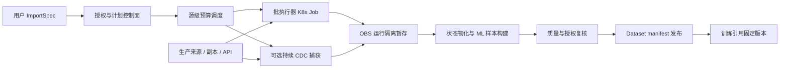

# 场景参考架构与演进

状态：P，设计建议。依赖[正确性](../patterns/correctness.md)、[治理](../patterns/governance.md)与[匹配](fit.md)。

控制面不传明文密码给用户。执行器按连接和授权获取受限身份，来源预算以数据库端点/集群为粒度，而不是以 Pod 为粒度。

## 建议执行协议

提交 → 验证授权/最终 DSL → 分配源预算 → RUNNING → STAGED → VALIDATED → READY。FAILED/CANCELLED 不发布。取消向来源传播并确认查询退出；授权撤销可在运行或发布前阻断。状态更新和检查点需幂等。

CDC 运行独立于单次训练数据集任务。历史快照及事件输入经状态物化后，再按领域用途产生版本；不能将每次训练触发解释为重新全量捕获。

## 分阶段改造

阶段 1：完善现有批查询。增加来源合同、secret_ref、DataGrant、源级限额、服务端超时/取消、幂等 run_id 和 manifest。退出条件：失败不暴露半份数据，撤权阻止发布，限额可验证。

阶段 2：按来源接入副本、快照或现成导出。退出条件：数据一致性声明清楚，源业务指标达标，成本可解释。

阶段 3：只为持续变更场景增加 CDC。退出条件：初始/增量衔接、日志过期、删除、重放和 DDL 测试通过，并具备运行维护方案。

这些阶段按需求选择；阶段 1 已满足的低频来源可以长期停留在阶段 1。
